<div align="center">



# MK8-online

### Prepare once. Race natively. Connect with friends.

**Created and maintained by [RatOne](https://github.com/Vnnc1)**

**English** · [Português (Brasil)](README.pt-BR.md)


[](LICENSE)

An experimental **Mario Kart 8 Deluxe 4.0.1** static recompilation project for Windows,
with a native launcher, a Vulkan runtime and multiplayer rooms under development.

[Download / Releases](https://github.com/Vnnc1/MK8-online/releases) · [Report an issue](https://github.com/Vnnc1/MK8-online/issues) · [Roadmap](docs/ROADMAP.md)

</div>

> [!IMPORTANT]
> Bring your own game files and console keys. This repository and its releases do not include ROMs, game assets, keys, saves or recompiled game code. The game is compiled locally from your own files.

> [!NOTE]
> **Open for testing, still experimental.** Races have completed in local tests, but visual defects, first-use shader stutters and growing VRAM usage remain. Multiplayer between separate PCs is not yet qualified. The 0.1.8 test installer adds preparation recovery, process coordination and the bundled Vulkan loader.

For diagnostics without game/firmware data, run `local/python/Scripts/python.exe scripts/verify-simulation.py --browser`. It exercises native adapters with synthetic callers and the real launcher UI; see [scope and prerequisites](docs/STATUS.md). It does not simulate MK8 rendering or measure game FPS/VRAM.

**Local Mii model experiment:** a private exported head now renders on the native driver using a derived RomFS overlay, corrected head axes and baked face textures. This is a static replacement for the male Normal Suit body, not a general GLB importer or online Mii renderer. See [evidence, reproduction and limitations](docs/STATUS.md). Original game assets and profiles remain unchanged.

## On the starting grid

**Mii parts, phase 1:** local AFL extraction produced 585 nonempty meshes and 247 textures with a hashed inventory. `toolchain/mii_library.py` reproduces this using a separately obtained, verified extractor/resource. These private assets are not bundled with the launcher; the composer below uses FFL to select and position the parts.

**Phase 2:** the isolated local composer builds distinct heads from CharInfo using FFL.js, including normals/materials, bounded hair editing and GLB export. Browser tests reopen both exports and compare their pixels to the preview; see [status](docs/STATUS.md).

**Phase 3:** the launcher now has **Perfil Mii → Editar Mii 3D**: select a saved profile, configure your local `AFLResHigh_2_3.dat`, edit Switch fields with a live head preview, then save the profile and its textured GLB together. Saved heads can be reopened/exported; profile changes invalidate stale heads. FFL.js/WASM code and its AGPL notice are bundled, while the AFL file stays private and is verified by hash. Native conversion is a separate step below. `python scripts/test-mii-composer.py` exercises the compiled debug launcher with disposable profiles and Chromium. See [third-party notices](docs/THIRD_PARTY.md) for the composition module's license.

**Phase 4:** `toolchain/mii_native_head.py` converts supported launcher GLBs into private BFRES/Yaz0 overlays. Two different editor heads rendered on the native male Normal Suit driver in the kart menu and the opening section of Mario Kart Stadium. The converter handles node transforms, bone axes/scale and baked face textures, with identity/hash checks and explicit rejection of unsupported parts. This remains a static shared-resource replacement, not independent heads for multiple players or a complete-race qualification. Reproduction and screenshots are recorded in [status](docs/STATUS.md).

**Phase 5:** with the private conversion tools configured, save the profile/model, then choose **Prepare and use in game** in the editor and **Play solo**. The launcher converts the head, verifies the result and applies the selected profile's overlay at the next launch. You can disable or reactivate a prepared head without converting again. Stale/corrupted models and launcher multiplayer rooms are rejected while enabled. The actual launcher-to-game flow was tested in the kart menu and opening lap with isolated saves. This development feature still requires local Python/Pillow, the compiled BFRES builder and the verified original male body; these resources are not bundled. See [setup, evidence and remaining limits](docs/STATUS.md).


| Area | Current progress | Next checkpoint |
| --- | --- | --- |
| Launcher | Native Windows window, guided preparation, installer, updates and reports; English and Brazilian Portuguese UI | End-to-end update against a published release |
| Solo racing | Four Mushroom Cup tracks completed, returning to cup selection | Full image, audio, controller and restart/save qualification |
| Performance | Around 60 FPS in the measured race sections on the test PC | Repeated cups, VRAM stability and more hardware |
| LAN / room codes | Two game instances raced on one PC; 12 transport clients tested | Two real PCs, internet relay and more than four actual players |
| Split-screen | Under investigation | Fix the two-player character-selection input issue |
| Nextendo | Opt-in prototype; real OAuth and NEX token retrieval validated | Qualify game TLS, MK8 login, lobby and a race on two PCs |

These are observed milestones, not a percentage-complete estimate. `gameplay_verified` remains `false` until the complete qualification passes. Detailed evidence and limitations: [technical status](docs/STATUS.md) and [roadmap](docs/ROADMAP.md) (Portuguese).

## What this project does

The pipeline translates the supported game's AArch64 executable to C and compiles it for Windows x64. A C/C++ runtime supplies graphics, audio, input and system services; the Rust/Tauri launcher manages preparation, builds, updates and rooms.

RatOne develops and maintains the MK8 adaptation, launcher and integration. The translation/runtime foundation comes from **SMM2Recomp and LASRecomp**, with additional credited work from other projects. See [third-party sources and licenses](docs/THIRD_PARTY.md).

## Get on track

**Nextendo developer test (unreleased):** run `powershell -File scripts/test-nextendo.ps1` with the rebuilt development launcher/runtime. Start solo, then open **F1 → Online → Nextendo account**. After browser login, select Nextendo and restart from the overlay after saving. Tokens and the test signing key stay in memory; closing the game requires signing in again. This is separate from launcher LAN rooms. Real OAuth/NEX-token retrieval passed; game login and racing remain unqualified. Official releases confirm exactly MK8 4.0.1. A real Online Play attempt reproduced 2306-0502: the MK8 TLS certificate does not match the inherited pin. The public Prelude CA also fails to authenticate that self-signed MK8 certificate. With explicit temporary trust for local testing, TLS passed and the game reached “You're spectating. Get ready!”. A resource/Mii-path null access still stops the transition; online racing is not qualified. The default pin is unchanged, certificate verification remains enabled, and official MK8 certificate/SPKI confirmation is still needed for distribution. No cloud saves or friends integration is included.

### Requirements

- **Windows x64** and WebView2. Tools setup provisions a private **Python 3.12 x64** automatically.
- A GPU and working graphics driver exposing **Vulkan 1.3 or newer**. Vulkan 1.2 is rejected at startup; API version alone does not qualify all required features or performance. A general minimum CPU/GPU specification has not been qualified.
- Your own base game, **4.0.1 update** and `prod.keys` from your console, or a supported extracted game folder.
- About **28 GiB free for extraction/preparation**, including a 4 GiB safety reserve. Keep additional space for source packages, tools and build caches. An SSD is recommended for preparation.
- Internet for the initial tool download (about 0.4 GiB installed, before build caches) and updates. Tools are shared across launcher versions.

Tools downloads a pinned CPython package, verifies SHA-256 and creates its local environment without changing system Python or PATH. Incompatible or incomplete environments are preserved in `local/python-backup-*` and recreated automatically. Available in 0.1.7; users of 0.1.6 can update through Support before retrying Tools.

Included in the 0.1.8 test release: readiness checks now use the private Python environment; package installation ignores external pip settings and requires verified binary wheels. Damaged download archives are fetched again, and invalid compilation-cache metadata triggers recovery instead of aborting preparation. These fixes require updating from 0.1.7 to 0.1.8. See [technical status](docs/STATUS.md).

Additional recovery checks cover interrupted generation receipts and missing/invalid prepared-runtime hashes: derived files are regenerated from verified sources rather than trusted without evidence. Preparation checks the 4 GiB reserve before import/runtime replacement and reports unavailable destination volumes. Launcher tool processes ignore external Python startup variables while preserving their local script imports.

Version 0.1.8 fixes also distinguish inaccessible files from corrupt caches: a sharing or permission error stops preparation without treating the affected import/runtime as disposable. File replacement preserves the previous destination until the new file can be published. Missing or unreadable mirror sources stop pruning; failed download publication preserves the downloaded file and reports the local problem. Resolve the lock/access issue or reconnect the same drive before retrying. No permissions or antivirus settings are changed automatically.

The source preparation now includes the pinned `vulkan-1.dll` loader next to the game and retains it during dependency cleanup. SDL loads this DLL dynamically, so scanning static imports alone missed it in 0.1.7. A compatible Vulkan 1.3 graphics driver is still required; bundling the loader does not install a GPU driver.

Additional local fixes (not yet released) verify tool readiness with a completion receipt and file hashes, even when no extra DLL downloads are needed. Before launching a game, a separate process checks the local Vulkan/SDL libraries and their Windows-resolved dependencies. Failures stop launch and are included as `vulkan-check.log` in support reports. The game uses the explicit local Vulkan path. This checks library loading, not GPU or gameplay compatibility, and does not delete game data or saves.

Version 0.1.8 also adds operation locks between launchers sharing data/tools and between pipeline runs sharing a data folder. Failed cancellation keeps the process tracked so cancellation can be retried. Cleanup rejects linked parent directories and stops on permission errors instead of forcing deletion. These protections are still under validation; see the remaining limitations in the technical status.

The 0.1.8 launcher supervises processes separately: closing or losing the launcher stops its tool/build processes, while a running game keeps its locks and can finish saving normally. Other instances cannot start another game with the same saves, rebuild, change paths or start an update against those resources. Games using separate data folders can share read-only tools. Closing the launcher still disconnects its multiplayer gateway; this does not provide session reconnection.

### Install and play

1. Download `MK8-online-<version>-setup.exe` from [Releases](https://github.com/Vnnc1/MK8-online/releases). Choose the application and data folders. Installation is per user, without administrator privileges.
2. Open **Install** in the launcher. Complete **Tools**, then select the base game and update in **Game files**. The launcher can find keys alongside the game; select your own key file if necessary. It stores the path.
3. Run **Build the game**, wait for completion, then choose **Play solo**. Progress, elapsed time and the build log are available during preparation.

**Language:** both the launcher and installer offer **English** and **Português (Brasil)** through the **Language / Idioma** selector. First launch follows your system/browser language, with English as the fallback. Your choice is saved in the data folder and survives restarts. This changes the launcher UI; the game's language is independent. Tool logs and external diagnostic details retain their original language.

An extracted folder must contain `exefs`, `romfs` and `control.nacp` (or `control/control.nacp`); select **I already have an extracted game folder**. The active profile is 4.0.1 AArch64. Other game versions, DLC and XCI/XCZ import still need validation.

The setup includes the prebuilt host runtime and a minimal FFmpeg for videos; the game code is compiled on your PC. Incomplete extraction/preparation is repaired on the next build. Data defaults to `%LOCALAPPDATA%\MK8-online` and is preserved across updates and uninstalling. To select another drive when starting the portable launcher:

```powershell
& .\Launcher.exe --data-dir E:\MK8-Local
```

Reuse the same data folder on subsequent launches. Older per-version data folders are not automatically migrated or deleted.

**Updates:** **Support → Check for updates** checks GitHub Releases, including prereleases. **Update now** downloads the setup, verifies its published SHA-256 and restarts the launcher after installation.

Local **0.1.9-test.1** includes a bounded fix for an absent Mii portrait request and its UI consumers, plus runtime logs in diagnostic reports. Both players must install the test setup and prepare the game build again with their existing data folders. Saves are retained; integrated Mii rendering and two-PC race qualification remain incomplete. This test version is not published on GitHub.

## Race with friends

### LAN rooms

Each PC needs its own prepared copy of the same game version. In **Multiplayer**, set your display name, create or discover a room and generate **New invitation** for each friend. Guests paste their individual invitations into the launcher. Invitations contain the host address: share them privately.

LAN discovery and traffic use UDP **47820** and depend on the network/firewall. The launcher selects the local address automatically; **Alternative address** supports a configured VPN or forwarded address. **Esc → Salas com amigos** opens the launcher's room tab from compatible runtime builds.

For **Radmin VPN**, both PCs must join the same VPN network. On the **host PC**, enter its Radmin IP followed by `:47820` under **Alternative address**, then generate a **new invitation** for each guest. Guests paste that invitation under **Join**; their alternative-address field does not override received invitations. Allow the host's UDP port through the firewall. Editing the address invalidates the displayed invitation; collapsing the address panel keeps the chosen address.

The launcher reports transport connections separately from the in-game lobby, excludes the host from the guest count, and shows troubleshooting after 20 seconds without confirmation. **Wireless Play is not implemented**; use **LAN Play** with launcher rooms. These local test changes are not a published release. Diagnostic collection in the working tree now also includes the runtime log beside the executable when launcher stdout is empty; this is not yet included in the previously shared VPN test installer.

After joining in the launcher:

1. Everyone selects **Play in room**.
2. At the game's main menu, hold **L + R** and click the **left stick** to reveal **LAN Play**.
3. The host selects **Create Room**; guests choose the host in **Lobby**.
4. Choose characters and karts; the host sets the race rules.

The game supports up to **12 LAN players**. Our transport tests cover 12 clients, but actual racing has only been tested with two game instances on one machine. Split-screen, two-PC play and full rooms need separate validation. Use **Multiplayer → How to test on two PCs** for the test procedure.

### Internet room codes

A launcher configured with a public relay can create a new `MK8-…` code for each internet room. Friends paste that code to obtain their own connection credentials. The host controls the game room; the relay forwards packets. Players make outbound connections, while the relay operator exposes the server ports.

**A public relay must be deployed and configured.** The current tests used a local relay; they do not establish internet connectivity or low latency. Relay location and each player's connection affect the result. The game's official **Online Play** and local wireless (`ldn`) are not part of this LAN integration.

<details>
<summary><strong>For operators: configure a relay</strong></summary>

Build the relay and run it on the server, replacing `PUBLIC_RELAY_IP`:

```text
cargo build --release --locked -p mk8-session --bin mk8-relay
mk8-relay 127.0.0.1:47819 0.0.0.0 PUBLIC_RELAY_IP 47820
```

Allow UDP **47820–47835**. Put the control endpoint `127.0.0.1:47819` behind an HTTPS proxy with a valid certificate, request-size limits and rate limiting. Keep internal HTTP on loopback. An HTTP-only tunnel cannot carry game UDP traffic.

Set `MK8_RELAY_URL` to that HTTPS endpoint before running `python scripts/package-launcher.py`, and distribute the resulting launcher to players. The environment variable also works when launching a development build. Loopback HTTP is accepted for local testing.

The daemon supports up to 16 rooms, with one host and up to 11 guests each. Rooms expire after four hours and are also removed after host inactivity. Treat codes and individual credentials as private.

</details>

### Steam rooms (experimental, `fix-multiplayer`)

When `steam_api64.dll` is detected locally (from `MK8_STEAM_DLL`, `<data-dir>/steam_api64.dll`, or a local Steam game installation) and the Steam client is running, **Multiplayer → Create Steam room** creates a Steamworks lobby (`ISteamMatchmaking`) and routes all MK8 LAN traffic over `ISteamNetworking` P2P Relay (SDR) without VPN or firewall port forwarding:

1. The host clicks **Create Steam room**, producing a single reusable `MK8S-…` room code and enabling **Invite friends on Steam** (`Shift+Tab` overlay).
2. Friends paste the `MK8S-…` code under **Join** (or join directly via Steam invite / `+connect_lobby <id>`), automatically negotiating their dedicated authenticated channel with the host over Steam P2P.
3. Once connected, everyone clicks **Play in room** and enters **LAN Play** (`L + R + left stick`) inside the game.

No proprietary Valve DLL is bundled in the repository. Two-PC racing over Steam Relay still requires separate qualification; `gameplay_verified` remains `false`.

### Nextendo: developer prototype

The local opt-in prototype uses a dedicated public PKCE client. Real OAuth and NEX-token retrieval passed; tokens remain in memory for this test stage. See [technical status](docs/STATUS.md) for evidence and test instructions.

**[Nextendo Network](https://nextendo.network/) game login, friends, matchmaking and racing remain unqualified.** The published 0.1.8 installer does not include this prototype. No release date or affiliation is implied; it does not replace the current LAN/relay path.

## Performance, with context

The latest local candidate completed all four Mushroom Cup tracks and returned to cup selection in an **18 min 19 s** run. On a **Xeon E5-2666 v3 / 16 GB RAM / RX 580 2048SP**, selected race sections measured:

| Track | Average FPS | p95 frame time |
| --- | ---: | ---: |
| Mario Kart Stadium | 59.99 | 17.46 ms |
| Water Park | 59.98 | 17.45 ms |
| Sweet Sweet Canyon | 59.97 | 17.46 ms |
| Thwomp Ruins | 59.99 | 17.33 ms |

These measurements exclude capture windows and do not guarantee 60 FPS throughout every scene or on other PCs. First-use shaders may still stutter or temporarily omit effects while compilation completes.

Recent changes fix command-list references surviving buffer/pool finalization and use preferred 128 MiB VMA allocation blocks. **VRAM still grows between tracks**: heap 0 reserved memory peaked at 1,648 MiB and remained reserved after returning to the menu. That figure is an allocator measurement, not total Windows GPU memory use; the isolated benefit of smaller blocks is still unproven. Direct image release remains experimental and disabled by default. See [measurements and remaining investigations](docs/STATUS.md).

Source changes dated 10 November add descriptor-pool and cubemap-history cleanup, growing shader lookup tables, deduplicated prefetch requests and a compilation-queue race fix. Native tests now explicitly enable assertions; the expanded suite and a full runtime build are checked separately from gameplay. Reduced VRAM or better FPS has **not** yet been measured. Run `local/python/Scripts/python.exe scripts/verify-graphics.py` after setting up the pinned tools and upstream sources. See [the validation checklist](docs/STATUS.md) before testing long sessions.

## Help improve the next lap

In **Support → Create report**, create a diagnostic ZIP and attach it to an [issue](https://github.com/Vnnc1/MK8-online/issues), with your CPU/GPU, launcher version, track/mode, steps to reproduce and expected result. For multiplayer, include reports from both PCs and describe the network setup.

Reports include game/build/tool logs and the build manifest. The launcher redacts personal paths and account names and excludes saves and keys; review attachments before sharing. Reports are stored in `<data folder>\data\reports`; a report is also created automatically after a game crash. Never post ROMs, console keys or private invitations.

Current priorities are repeated-cup VRAM stability, shader/frame-time consistency, visual fidelity, split-screen input and multiplayer on separate machines. Local source builds now expose **Mii profile**: create/edit/select profiles, an approximate procedural 3D preview, full Switch field editing and lossless `.charinfo` import/export. The runtime menu can open the editor; changes apply on the next game launch, and saves remain shared. An experimental option mounts the player's extracted MiiModel resources and restores the game's original model path. **Actual in-game heads, portraits and animations remain unqualified; this does not implement Nextendo.** See [Mii setup and test instructions](docs/STATUS.md). Full qualification must cover image, audio, physical controls, clock speed and restart/save together.

## Build and contribute

Development is consolidated on `fix-chore`, including the previously unpushed master fixes and Mii editor/resource support. The current focus is creating and editing Miis, integrating their heads and portraits into MK8, then qualifying multiplayer. See [the current evidence and remaining requirements](docs/STATUS.md).

**Exported Mii models:** in **Mii profile**, choose **Inspect exported GLB** to view a self-contained GLB locally, isolate its head, inspect wireframe/skeleton and compare an accompanying `.miic` with embedded data. Files stay in the browser. This does not install a model into MK8 or convert newer `.miic` formats into Switch CharInfo.

**Native Mii integration diagnostic:** `scripts/test-race.py time-trial --character mii --last-frame 4800` selects the first Mii and Normal Suit using isolated saves. The current test reaches the track with the game's body and kart, but no head. The GLB-to-native rendering bridge is still unimplemented; this is a reproducible baseline, not model qualification. See [evidence and tracing](docs/STATUS.md).

Development needs Rust, Python 3.12 x64, PowerShell 7 and .NET 10 x64 for the importer. Disk-type detection is optional: Windows storage drivers may report an unknown type, including on CI virtual disks. Start from the repository root:

```powershell
.\scripts\start-launcher.ps1
```

The script downloads the pinned upstream sources, verifies their hashes, builds the launcher and opens it. Prepare your game through the same launcher workflow. To package the portable launcher:

```powershell
python scripts/package-launcher.py
```

Output: `target/portable/Launcher.exe`. Full packaging prerequisites and release checks are in [RELEASING.md](docs/RELEASING.md). Keep adaptations in `runtime/mk8` and `toolchain`; preparation applies them to a verified build copy. Do not edit upstream snapshots or generated game code directly. Follow [AGENTS.md](AGENTS.md) and run the tests for the changed area.

| Location | Responsibility |
| --- | --- |
| `apps/launcher` | Native launcher, web interface, installer, updates and reports |
| `crates/installer`, `crates/manifest`, `crates/build-manager` | Installation, validation and build supervision |
| `crates/session`, `crates/transport` | Rooms, invitations, relay and authenticated transport |
| `toolchain`, `runtime/mk8` | Recompilation pipeline and MK8 runtime adaptations |
| `games/mk8d` | Version profiles, symbols and game configuration |
| `scripts`, `tests` | Preparation, packaging and regression checks |
| `upstream/manifests` | Pinned source manifests; downloaded snapshots stay outside Git |
| `local`, `target`, `prebuilt` | Private data and generated artifacts, ignored by Git |

## Credits and license

**MK8-online is created and maintained by RatOne.** Upstream authors retain credit and ownership of their contributions. Attribution and dependency notices are collected in [THIRD_PARTY.md](docs/THIRD_PARTY.md) and [docs/licenses](docs/licenses).

Project code is licensed under **[GPL-3.0-or-later](LICENSE)**. Dependencies retain their own licenses; the SMM2Recomp snapshot includes GPLv3, while LASRecomp includes MIT notices. The combined project cannot simply be relabeled MIT. The license does not grant rights to Nintendo's game code, assets or trademarks.

An independent community project, not affiliated with or endorsed by Nintendo. Mario Kart and related names belong to their respective owners.
