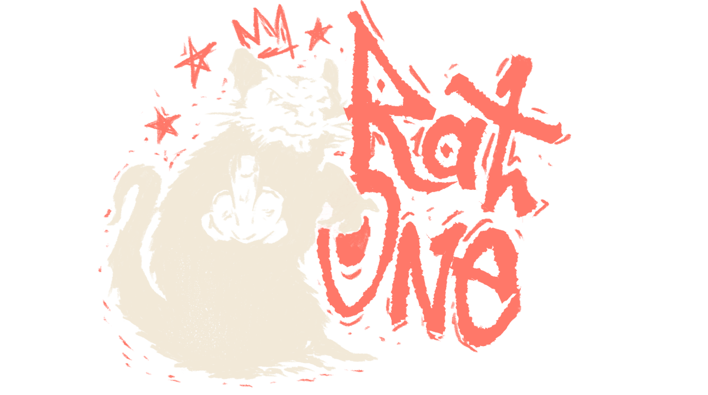

# MK8-online

### Prepare once. Race natively. Connect with friends.

**Created and maintained by [RatOne](https://github.com/Vnnc1)**

**English** · [Português (Brasil)](README.pt-BR.md)

[Download](https://github.com/Vnnc1/MK8-online/releases) · [User guide](docs/en/GUIDE.md) · [Status](docs/en/STATUS.md) · [Roadmap](docs/en/ROADMAP.md) · [Report an issue](https://github.com/Vnnc1/MK8-online/issues) · [Discord](https://discord.gg/4Yg4Axpkb6)

MK8-online is an experimental static recompilation of **Mario Kart 8 Deluxe 4.0.1** for Windows x64 and Linux amd64. The game's AArch64 executable is translated to C and compiled on your PC. A Vulkan runtime supplies graphics, audio, input and system services. A Rust/Tauri launcher handles preparation, builds, updates, Miis and online play.

> [!IMPORTANT]
> Bring your own game files and console keys. This repository and its releases contain no ROMs, game assets, keys, saves or recompiled game code. The game is compiled locally from your own files.

## Features

- **Native build:** the game runs as a native Windows or Linux executable, with no emulator.
- **Guided launcher:** installation, game build, updates, uninstall and diagnostic reports, in English, Brazilian Portuguese and Spanish.
- **Mii creator:** your Mii appears in game portraits, suits, the driver and the minimap.
- **Online play:** native matchmaking through [Nextendo](https://nextendo.network/), plus Steam rooms with friend invites.
- **Graphics:** internal resolution scaling with FSR 1/3/4 and DLSS, plus experimental ultrawide and frame generation.
- **Fullscreen:** the idle mouse pointer hides by default. Change this in Video settings.
- **Controllers:** SDL gamepads, keyboard, Switch Pro Controller and Joy-Cons, with HD Rumble, motion steering and local split-screen.
- **Extra content:** optional Booster Course Pass DLC and an experimental CTGP Deluxe course pack, both from your own files, plus RomFS mods you install yourself (textures, models, music).

## Download

| Platform | Package |
| --- | --- |
| Windows x64 | [Installer](https://github.com/Vnnc1/MK8-online/releases/download/v0.6.3/MK8-online-0.6.3-setup.exe) · [Portable ZIP](https://github.com/Vnnc1/MK8-online/releases/download/v0.6.3/MK8-online-0.6.3-portable.zip) |
| Linux amd64 (experimental) | [AppImage](https://github.com/Vnnc1/MK8-online/releases/download/v0.6.3/MK8-online-0.6.3-linux-x86_64.AppImage) · [tar.gz](https://github.com/Vnnc1/MK8-online/releases/download/v0.6.3/MK8-online-0.6.3-linux-x86_64.tar.gz) · [Linux guide](docs/en/LINUX.md) |

[Release notes for 0.6.3](docs/releases/0.6.3.md) · [All releases](https://github.com/Vnnc1/MK8-online/releases)

## Requirements

- Windows x64 with WebView2, or Linux amd64 ([details](docs/en/LINUX.md))
- A GPU and driver with **Vulkan 1.3** or newer
- Your own base game, **4.0.1 update** and `prod.keys`
- About **28 GiB** of free disk space (SSD recommended) and an internet connection for the first setup

## Quick start

1. Run the installer and choose the application and data folders. No administrator rights are needed.
2. In **Install**, complete **Tools**, then select your base game and update in **Game files**.
3. Run **Build the game**. The first build takes around 30 minutes.
4. Create a Mii in **Mii profile**, then choose **Play solo**, **Play on Nextendo** or **Multiplayer**.

**Upgrading?** Use **Support → Update now**, keep your data folder, then run **Update the build** if the launcher asks. The [user guide](docs/en/GUIDE.md) covers graphics, controllers, online play, DLC, CTGP, portable mode and troubleshooting.

## Project status

MK8-online is a **public test**. It reaches the menu and completes full cups, and online races have been played on Nextendo, but it has known defects and is **not qualified**: `gameplay_verified` and `multiplayer_verified` remain `false`. On the reference PC (RX 580), measured race sections hold around 60 FPS. First-use shader stutters and VRAM growth between courses are still open.

[Current status](docs/en/STATUS.md) · [Roadmap](docs/en/ROADMAP.md)

## Contributing

Bug reports with a diagnostic ZIP from **Support → Create report** are the most useful help ([how to report](docs/en/GUIDE.md#reporting-a-problem)). To build from source or send changes, read [CONTRIBUTING.md](CONTRIBUTING.md). AI agents should also follow [AGENTS.md](AGENTS.md).

## Credits and license

**MK8-online is created and maintained by RatOne.** The translation and runtime foundation comes from **SMM2Recomp** and **LASRecomp**, with additional credited work from other projects and contributors. Upstream authors keep credit and ownership of their contributions. The Mii creator draws faces with [FFL.js](https://github.com/ariankordi/FFL.js) (AGPL-3.0). See [third-party sources and licenses](docs/en/THIRD_PARTY.md) and [docs/licenses](docs/licenses).

Project code is licensed under **[GPL-3.0-or-later](LICENSE)**. Dependencies keep their own licenses: the SMM2Recomp snapshot includes GPLv3, LASRecomp includes MIT notices, and the setup carries FFmpeg (LGPL 2.1), with its source attached to each release. The license grants no rights to Nintendo's game code, assets or trademarks.

MK8-online is an independent community project. It is not affiliated with or endorsed by Nintendo or Valve. Mario Kart and related names belong to their respective owners.
