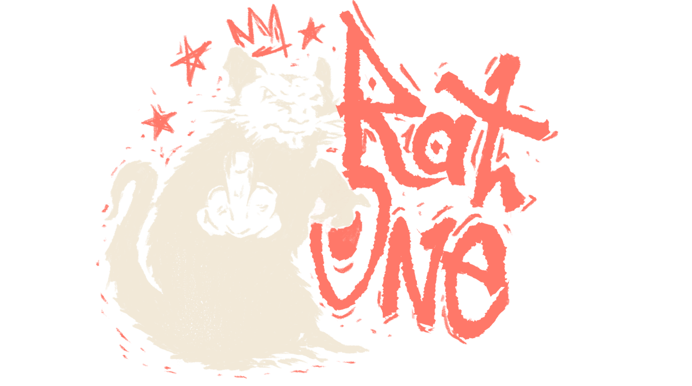

# MK8-online

### Prepare uma vez. Corra nativamente. Conecte-se com amigos.

**Criado e mantido por [RatOne](https://github.com/Vnnc1)**

[English](README.md) · **Português (Brasil)**

[Download](https://github.com/Vnnc1/MK8-online/releases/latest) · [Guia do usuário](docs/GUIDE.pt-BR.md) · [Guia Linux](docs/LINUX.md) · [Roteiro](docs/ROADMAP.md) · [Relatar um problema](https://github.com/Vnnc1/MK8-online/issues) · [Discord](https://discord.gg/4Yg4Axpkb6)

O MK8-online é uma recompilação estática experimental do **Mario Kart 8 Deluxe 4.0.1** para Windows x64 e Linux amd64. O executável AArch64 do jogo é traduzido para C e compilado no seu PC. Um runtime Vulkan fornece gráficos, áudio, entrada e serviços de sistema. Um launcher em Rust/Tauri cuida da preparação, das builds, das atualizações, dos Miis e do jogo online.

> [!IMPORTANT]
> Use seus próprios arquivos do jogo e as chaves do seu console. O repositório e as releases não incluem ROMs, recursos do jogo, chaves, saves nem código recompilado do jogo. A compilação acontece localmente, a partir dos seus arquivos.

## Como funciona

1. **Seus arquivos.** Você seleciona o seu jogo base, a atualização 4.0.1 e as chaves do seu console. O launcher confere tudo por hash e extrai os arquivos na sua pasta de dados.
2. **Recompilação no seu PC.** O pipeline traduz o código AArch64 do jogo para C, aplica as adaptações verificadas do projeto e compila com ferramentas fixadas, gerando bibliotecas nativas de Windows ou Linux. Nada recompilado é baixado; a primeira build leva cerca de 30 minutos e as seguintes reaproveitam o que já foi feito.
3. **Runtime nativo.** O jogo roda como programa nativo. O runtime implementa os serviços de console que o jogo espera e desenha por Vulkan, com configurações, Menu e diagnósticos próprios.
4. **Launcher.** Uma janela prepara, compila, atualiza e abre o jogo, cuida dos seus Miis, configurações e conteúdos opcionais e conecta você aos amigos pelo Nextendo ou por salas Steam.

## Recursos

- **Build nativa:** o jogo roda como executável nativo de Windows ou Linux, sem emulador.
- **Launcher guiado:** instalação, build do jogo, atualizações, desinstalação e relatórios de diagnóstico, em inglês, português do Brasil e espanhol.
- **Criador de Mii:** seu Mii aparece nos retratos, nas roupas, no piloto e no minimapa do jogo.
- **Jogo online:** matchmaking nativo pelo [Nextendo](https://nextendo.network/), além de salas Steam com convites de amigos.
- **Gráficos:** escala da resolução interna com FSR 1/3/4 e DLSS, opções de bloom e de câmera, ultrawide e geração de quadros experimentais.
- **Menu do jogo:** cinco temas que compartilham os ajustes com o launcher, incluindo um Menu nativo no estilo do jogo.
- **Controles:** controles SDL, teclado, Pro Controller e Joy-Con do Switch, com atribuição de jogadores, vibração HD, direção por movimento e tela dividida local.
- **Conteúdo extra:** DLC Booster Course Pass opcional e pacote de pistas CTGP Deluxe experimental, ambos a partir dos seus arquivos.

## Download

| Plataforma | Pacote |
| --- | --- |
| Windows x64 | Instalador (`MK8-online-<versão>-setup.exe`) ou ZIP portátil |
| Linux amd64 (experimental) | AppImage ou tarball · [Guia Linux](docs/LINUX.md) |

Todos os pacotes ficam na [versão mais recente](https://github.com/Vnnc1/MK8-online/releases/latest), cada um com o arquivo SHA-256.

## Requisitos

- Windows x64 com WebView2, ou Linux amd64 ([detalhes](docs/LINUX.md))
- GPU e driver com **Vulkan 1.3** ou mais novo
- Seu próprio jogo base, a **atualização 4.0.1** e o `prod.keys`
- Cerca de **28 GiB** livres em disco (SSD recomendado) e internet na primeira configuração

## Início rápido

1. Execute o instalador e escolha as pastas do aplicativo e dos dados. Não é preciso ser administrador.
2. Em **Instalar**, conclua **Ferramentas** e selecione o jogo base e a atualização em **Arquivos do jogo**.
3. Rode **Build do jogo**.
4. Crie um Mii em **Perfil Mii** e escolha **Jogar solo**, **Jogar no Nextendo** ou **Multijogador**.

Quando sair uma versão nova, use **Suporte → Atualizar agora**, mantenha a pasta de dados e rode **Atualizar a build** se o launcher pedir. O [guia do usuário](docs/GUIDE.pt-BR.md) cobre gráficos, controles, jogo online, DLC, CTGP, modo portátil e solução de problemas.

## Estado do projeto

O MK8-online está em **teste público**. Ele chega ao menu, completa copas inteiras e já teve corridas online, mas tem defeitos conhecidos e **não está qualificado**: `gameplay_verified` continua `false`. Cada mudança, teste e problema em aberto fica registrado no [estado técnico](docs/STATUS.md).

## Contribuir

A ajuda mais útil são relatos de bugs com o ZIP de diagnóstico de **Suporte → Gerar relatório** ([como relatar](docs/GUIDE.pt-BR.md#relatar-um-problema)). Para compilar a partir do código-fonte no Windows, rode `.\scripts\start-launcher.ps1`; ele baixa as fontes upstream fixadas, confere os hashes, compila o launcher e o abre. Os passos de release estão em [RELEASING.md](docs/RELEASING.md). Colaboradores e agentes de IA seguem o [AGENTS.md](AGENTS.md): as adaptações ficam em `runtime/mk8` e `toolchain`, nunca em `upstream` nem no código gerado.

## Créditos e licença

**O MK8-online é criado e mantido por RatOne.** A base de tradução e de runtime vem do **SMM2Recomp** e do **LASRecomp**, com outros trabalhos creditados de outros projetos e colaboradores. O porte nativo para Linux e a integração de FSR/DLSS foram contribuídos por mitch030504. Os autores upstream mantêm o crédito e a autoria das suas contribuições. O criador de Mii desenha os rostos com o [FFL.js](https://github.com/ariankordi/FFL.js) (AGPL-3.0). Veja [fontes de terceiros e licenças](docs/THIRD_PARTY.md) e [docs/licenses](docs/licenses).

O código do projeto é licenciado sob **[GPL-3.0-or-later](LICENSE)**. As dependências mantêm suas próprias licenças: o snapshot do SMM2Recomp inclui GPLv3, o LASRecomp inclui avisos MIT e o setup leva o FFmpeg (LGPL 2.1), com o código-fonte anexado a cada release. A licença não concede direitos sobre o código, os recursos ou as marcas da Nintendo.

O MK8-online é um projeto comunitário independente, sem afiliação nem endosso da Nintendo ou da Valve. Mario Kart e nomes relacionados pertencem aos respectivos donos.
