<div align="center">



# MK8-online

### Prepare uma vez. Corra nativamente. Conecte-se com amigos.

**Criado e mantido por [RatOne](https://github.com/Vnnc1)**

[English](README.md) · **Português (Brasil)**


[](LICENSE)

Projeto experimental de recompilação estática de **Mario Kart 8 Deluxe 4.0.1** para Windows,
com launcher nativo, runtime Vulkan e salas multijogador em desenvolvimento.

[Download / Releases](https://github.com/Vnnc1/MK8-online/releases) · [Relatar um problema](https://github.com/Vnnc1/MK8-online/issues) · [Roteiro](docs/ROADMAP.md)

</div>

> [!IMPORTANT]
> Use seus próprios arquivos do jogo e as chaves do seu console. O repositório e as releases não incluem ROMs, recursos do jogo, chaves, saves ou código recompilado do jogo. A compilação acontece localmente, a partir dos seus arquivos.

> [!NOTE]
> **Disponível para testes, ainda experimental.** Corridas foram concluídas em testes locais, mas persistem defeitos visuais, engasgos no primeiro uso de shaders e crescimento de VRAM. Multiplayer entre PCs diferentes ainda não foi qualificado. O instalador de testes 0.1.8 inclui recuperação da preparação, coordenação de processos e o carregador Vulkan.

## No grid de largada

| Área | Progresso atual | Próxima etapa |
| --- | --- | --- |
| Launcher | Janela nativa, preparação guiada, instalador, atualizações e relatórios; interface em inglês e PT-BR | Atualização ponta a ponta contra uma release publicada |
| Corrida solo | Quatro pistas da Mushroom Cup concluídas, com retorno à seleção de copas | Qualificação conjunta de imagem, áudio, controle e reinício/save |
| Desempenho | Cerca de 60 FPS nos trechos medidos no PC de teste | Repetir copas, estabilizar VRAM e testar mais hardware |
| LAN / códigos de sala | Dois jogos correram no mesmo PC; transporte testado com 12 clientes | Dois PCs reais, relay na internet e mais de quatro jogadores reais |
| Tela dividida | Em investigação | Corrigir entrada na seleção de personagens para dois jogadores |
| Nextendo | Investigação prevista | Avaliar integração com este runtime nativo |

São marcos observados, sem estimativa artificial de porcentagem concluída. `gameplay_verified` permanece `false` até passar pela qualificação completa. Evidências e limitações: [estado técnico](docs/STATUS.md) e [roteiro](docs/ROADMAP.md).

## O que este projeto faz

O pipeline traduz o executável AArch64 da versão suportada para C e o compila para Windows x64. Um runtime C/C++ fornece gráficos, áudio, entrada e serviços de sistema; o launcher Rust/Tauri gerencia preparação, builds, atualizações e salas.

RatOne desenvolve e mantém a adaptação MK8, o launcher e a integração. A base do tradutor/runtime vem de **SMM2Recomp e LASRecomp**, com contribuições de outros projetos devidamente creditadas. Veja [origens e licenças de terceiros](docs/THIRD_PARTY.md).

## Entre na pista

### Requisitos

- **Windows x64** e WebView2. A etapa Ferramentas instala um **Python 3.12 x64** privado durante a etapa Ferramentas.
- GPU e driver gráfico que exponham **Vulkan 1.3 ou superior**. Vulkan 1.2 é rejeitado na inicialização; a versão da API sozinha não qualifica todos os recursos necessários nem o desempenho. Ainda não há especificação mínima geral de CPU/GPU qualificada.
- Seu jogo base, **atualização 4.0.1** e `prod.keys` do seu console, ou uma pasta extraída compatível.
- Cerca de **28 GiB livres para extração/preparação**, incluindo 4 GiB de reserva. Separe espaço adicional para os pacotes de origem, ferramentas e caches de compilação. SSD recomendado para a preparação.
- Internet para baixar as ferramentas inicialmente (cerca de 0,4 GiB instalados, antes dos caches) e atualizar. As ferramentas são compartilhadas entre versões do launcher.

Ferramentas baixa CPython fixado, verifica SHA-256 e cria o ambiente local sem alterar o Python do sistema ou o PATH. Ambientes incompatíveis ou incompletos são preservados em `local/python-backup-*` e recriados automaticamente. Disponível na 0.1.7; usuários da 0.1.6 podem atualizar pelo Suporte antes de repetir Ferramentas.

Incluído na versão de testes 0.1.8: a verificação de prontidão usa o Python privado; a instalação ignora configurações externas do pip e exige wheels binários com hashes verificados. Arquivos de download danificados são baixados novamente, e metadados inválidos do cache de compilação acionam recuperação em vez de interromper a preparação. Essas correções exigem atualizar da 0.1.7 para a 0.1.8. Veja o [estado técnico](docs/STATUS.md).

As verificações de retomada também cobrem recibos de geração interrompidos e hashes ausentes/inválidos do runtime preparado: arquivos derivados são regenerados das fontes verificadas. A preparação verifica a reserva de 4 GiB antes da importação/substituição do runtime e informa quando a unidade de destino está indisponível. Processos de ferramentas iniciados pelo launcher ignoram variáveis externas de inicialização do Python, preservando os imports locais dos scripts.

As correções da 0.1.8 também distinguem arquivos inacessíveis de caches corrompidos: erro de compartilhamento ou permissão interrompe a preparação sem considerar a importação/runtime afetado descartável. A substituição de cada arquivo preserva o destino anterior até conseguir publicar o novo. Origem ausente ou ilegível interrompe a limpeza do espelho; falha ao publicar um download preserva o arquivo baixado e informa o problema local. Resolva o bloqueio/acesso ou reconecte a mesma unidade antes de tentar novamente. Nenhuma permissão ou configuração de antivírus é alterada automaticamente.

A preparação nas fontes agora inclui o carregador `vulkan-1.dll` fixado ao lado do jogo e o preserva na limpeza de dependências. O SDL carrega essa DLL dinamicamente; verificar apenas imports estáticos a deixava de fora na 0.1.7. Continua sendo necessário um driver gráfico compatível com Vulkan 1.3: incluir o carregador não instala o driver da GPU.

A versão 0.1.8 também bloqueia operações concorrentes entre launchers que compartilham dados/ferramentas e entre execuções do pipeline na mesma pasta de dados. Falhas no cancelamento mantêm o processo sob controle para permitir nova tentativa. A limpeza rejeita diretórios pais com links e para diante de erros de permissão, sem forçar exclusões. Essas proteções continuam em validação; os limites restantes estão no estado técnico.

O launcher 0.1.8 supervisiona os processos separadamente: fechar ou perder o launcher interrompe suas ferramentas/builds, enquanto o jogo ativo mantém os bloqueios e pode concluir o salvamento normalmente. Outras instâncias não podem abrir outro jogo com os mesmos saves, recompilar, alterar caminhos ou iniciar atualização desses recursos. Jogos com pastas de dados diferentes podem compartilhar ferramentas somente para leitura. Fechar o launcher ainda desconecta seu gateway multijogador; isso não implementa reconexão de sessão.

### Instalar e jogar

1. Baixe `MK8-online-<versão>-setup.exe` em [Releases](https://github.com/Vnnc1/MK8-online/releases). Escolha as pastas do programa e dos dados. A instalação é por usuário, sem administrador.
2. Abra **Instalar** no launcher. Conclua **Ferramentas** e selecione jogo base e atualização em **Arquivos do jogo**. As chaves podem ser encontradas ao lado do jogo; selecione o arquivo do seu console se necessário. O launcher guarda o caminho.
3. Execute **Build do jogo**, espere terminar e escolha **Jogar solo**. A preparação mostra progresso, tempo decorrido e acesso ao log.

**Idioma:** launcher e instalador oferecem **English** e **Português (Brasil)** no seletor **Idioma / Language**. A primeira abertura segue o idioma do sistema/navegador, com inglês como alternativa. A escolha fica salva na pasta de dados e continua após reiniciar. Isso traduz a interface do launcher; o idioma do jogo é independente. Logs de ferramentas e detalhes externos de diagnóstico mantêm o idioma original.

Uma pasta extraída precisa conter `exefs`, `romfs` e `control.nacp` (ou `control/control.nacp`); selecione **Já tenho o jogo extraído numa pasta**. O perfil ativo é 4.0.1 AArch64. Outras versões, DLC e importação XCI/XCZ ainda precisam de validação.

A importação direta de NSP/NSZ aceita duas variantes verificadas do programa base, mantendo a conferência integral dos hashes e da atualização 4.0.1. Outros conteúdos base continuam sem suporte; nesse caso, use uma pasta extraída compatível. Os detalhes da validação estão no [estado técnico](docs/STATUS.md).

O setup inclui o runtime host pré-compilado e um FFmpeg mínimo para vídeos; o código do jogo é compilado no seu PC. Extrações/preparações incompletas são reparadas na build seguinte. Os dados ficam por padrão em `%LOCALAPPDATA%\MK8-online` e são preservados nas atualizações e na desinstalação. Para escolher outro disco ao iniciar o launcher portátil:

```powershell
& .\Launcher.exe --data-dir E:\MK8-Local
```

Use a mesma pasta nas próximas aberturas. Pastas antigas de dados por versão não são migradas nem apagadas automaticamente.

**Atualizações:** **Suporte → Verificar atualizações** consulta as Releases do GitHub, incluindo pré-releases. **Atualizar agora** baixa o setup, verifica o SHA-256 publicado e reabre o launcher após instalar.

## Corra com amigos

### Salas LAN

Cada PC precisa preparar sua própria cópia da mesma versão do jogo. Em **Multijogador**, salve seu nome, crie ou busque uma sala e gere **Novo convite** para cada amigo. Os convidados colam seus convites individuais no launcher. O convite contém o endereço do anfitrião: compartilhe em privado.

A descoberta e o tráfego LAN usam UDP **47820** e dependem da rede/firewall. O launcher escolhe o endereço local automaticamente; **Endereço alternativo** aceita uma VPN ou um endereço com redirecionamento configurado. **Esc → Salas com amigos** abre a aba de salas em builds compatíveis do runtime.

Após conectar no launcher:

1. Todos escolhem **Jogar na sala**.
2. No menu principal do jogo, segure **L + R** e pressione o **analógico esquerdo** para mostrar **LAN Play**.
3. O anfitrião escolhe **Create Room**; os convidados selecionam seu nome em **Lobby**.
4. Cada jogador escolhe personagem e kart; o anfitrião define as regras.

O jogo admite até **12 jogadores em LAN**. Os testes de transporte cobrem 12 clientes, mas corridas reais só foram testadas com duas instâncias em uma máquina. Tela dividida, dois PCs e salas cheias precisam de validação separada. Consulte **Multijogador → Como testar em duas máquinas**.

### Códigos de sala pela internet

Um launcher configurado com relay público pode criar um novo código `MK8-…` para cada sala pela internet. Os amigos colam o código para receber suas credenciais individuais. O anfitrião controla a sala do jogo; o relay encaminha os pacotes. Jogadores fazem conexões de saída, enquanto o operador do relay disponibiliza as portas do servidor.

**É necessário hospedar e configurar um relay público.** Os testes atuais usaram relay local; não comprovam conectividade pela internet nem baixa latência. A localização do relay e a conexão de cada jogador influenciam o resultado. **Online Play** oficial e comunicação local sem fio (`ldn`) não fazem parte desta integração LAN.

<details>
<summary><strong>Para operadores: configurar um relay</strong></summary>

Compile e execute no servidor, substituindo `IP_PUBLICO_DO_RELAY`:

```text
cargo build --release --locked -p mk8-session --bin mk8-relay
mk8-relay 127.0.0.1:47819 0.0.0.0 IP_PUBLICO_DO_RELAY 47820
```

Libere UDP **47820–47835**. Publique o controle `127.0.0.1:47819` atrás de proxy HTTPS com certificado válido, limite de tamanho e taxa de requisições. Mantenha o HTTP interno em loopback. Um túnel apenas HTTP não encaminha o UDP do jogo.

Defina `MK8_RELAY_URL` com esse endereço HTTPS antes de executar `python scripts/package-launcher.py` e distribua o launcher resultante aos jogadores. A variável também funciona ao iniciar uma build de desenvolvimento. HTTP em loopback é aceito para testes locais.

O daemon admite até 16 salas, cada uma com anfitrião e até 11 convidados. Elas expiram após quatro horas e também são removidas por inatividade do anfitrião. Códigos e credenciais individuais são privados.

</details>

### Nextendo: uma direção futura

Investigar a **[Nextendo Network](https://nextendo.network/)** está no roteiro para oferecer uma alternativa de serviço online. **Esta build ainda não integra Nextendo.** Contas, amigos e matchmaking exigiriam trabalho de compatibilidade e validação neste runtime nativo. É uma intenção de desenvolvimento, sem data anunciada ou vínculo presumido; não substitui o caminho LAN/relay atual.

## Desempenho, com contexto

O candidato local mais recente percorreu as quatro pistas da Mushroom Cup e voltou à seleção de copas em **18 min 19 s**. No **Xeon E5-2666 v3 / 16 GB RAM / RX 580 2048SP**, os trechos de corrida selecionados mediram:

| Pista | FPS médio | Tempo por quadro p95 |
| --- | ---: | ---: |
| Mario Kart Stadium | 59,99 | 17,46 ms |
| Water Park | 59,98 | 17,45 ms |
| Sweet Sweet Canyon | 59,97 | 17,46 ms |
| Thwomp Ruins | 59,99 | 17,33 ms |

As medições excluem janelas de captura e não garantem 60 FPS em todas as cenas ou em outros PCs. O primeiro uso de shaders ainda pode causar engasgos ou ausência temporária de efeitos durante a compilação.

## Ajude a melhorar a próxima volta

Em **Suporte → Gerar relatório**, crie um ZIP de diagnóstico e anexe a uma [issue](https://github.com/Vnnc1/MK8-online/issues), informando CPU/GPU, versão do launcher, pista/modo, passos para reproduzir e resultado esperado. Para multiplayer, inclua relatórios dos dois PCs e descreva a rede.

Os relatórios contêm logs do jogo, build e ferramentas e o manifesto da build. O launcher oculta caminhos pessoais e nomes de conta e exclui saves e chaves; revise os anexos antes de compartilhar. Os arquivos ficam em `<pasta de dados>\data\reports`; um relatório também é criado automaticamente após falha do jogo. Nunca publique ROMs, chaves do console ou convites privados.

As prioridades são estabilizar VRAM ao repetir copas, melhorar shaders/tempo por quadro e fidelidade visual, corrigir a entrada em tela dividida e testar multiplayer entre máquinas. Modelos Mii não estão integrados ao jogo; o launcher atual não oferece editor de perfis. A qualificação completa deve verificar imagem, áudio, controle físico, velocidade do relógio e reinício/save juntos.

## Compilar e contribuir

O desenvolvimento exige Rust, Python 3.12 x64, PowerShell 7 e .NET 10 x64 para o importador. Na raiz do repositório:

```powershell
.\scripts\start-launcher.ps1
```

O script baixa as fontes fixadas do upstream, verifica os hashes, compila e abre o launcher. Prepare seu jogo pelo mesmo fluxo da interface. Para empacotar o launcher portátil:

```powershell
python scripts/package-launcher.py
```

Saída: `target/portable/Launcher.exe`. Requisitos completos de empacotamento e checagens de release estão em [RELEASING.md](docs/RELEASING.md). Mantenha adaptações em `runtime/mk8` e `toolchain`; a preparação aplica as mudanças a uma cópia de build verificada. Não edite snapshots do upstream ou código gerado do jogo diretamente. Siga [AGENTS.md](AGENTS.md) e execute os testes da área alterada.

| Local | Responsabilidade |
| --- | --- |
| `apps/launcher` | Launcher nativo, interface web, instalador, atualizações e relatórios |
| `crates/installer`, `crates/manifest`, `crates/build-manager` | Instalação, validação e supervisão de builds |
| `crates/session`, `crates/transport` | Salas, convites, relay e transporte autenticado |
| `toolchain`, `runtime/mk8` | Pipeline de recompilação e adaptações MK8 do runtime |
| `games/mk8d` | Perfis de versão, símbolos e configuração do jogo |
| `scripts`, `tests` | Preparação, empacotamento e regressões |
| `upstream/manifests` | Manifestos fixados; snapshots baixados ficam fora do Git |
| `local`, `target`, `prebuilt` | Dados privados e artefatos gerados, ignorados pelo Git |

### Configurações do jogo

Os avisos do launcher aparecem em um painel fixo no topo da janela, visível durante a rolagem e ao trocar de aba. Use **Fechar aviso** (×) para dispensá-los. A entrada tem uma animação curta, desativada quando o sistema solicita redução de movimento.

As opções gerais ficam em **Configurações**: vídeo, áudio, idioma do jogo, ícones dos botões, posição dos controles e mapeamento de teclado/controle. O launcher usa o mesmo `user-no-mii/mk8d.ini` do menu F1. Clique em **Salvar configurações** para aplicar no próximo início do jogo; **Recarregar do jogo** recupera os valores gravados pelo menu F1. Alterações não salvas permanecem na tela durante as atualizações de estado. Durante o salvamento e a leitura de confirmação, os campos e os botões Salvar/Recarregar ficam bloqueados; uma falha libera a edição sem descartar os valores pendentes. Comentários e opções não editadas são preservados.

As configurações não podem ser salvas enquanto o jogo ou uma preparação usa os dados. Os mapeamentos são selecionados em listas; atribuir uma tecla ou botão já usado troca os dois destinos, como no menu F1. Ações de conta, instalação de mods e saída continuam no menu do jogo. Salas continuam em **Multijogador**.

### Conteúdo adicional no launcher

Após preparar o jogo, abra **Instalar → Conteúdo adicional**. Selecione o NSP do Booster Course Pass e, quando necessário, as chaves do seu console; clique em **Importar DLC NSP…**. O launcher mostra o estado da operação e seu log. Uma build antiga precisa ser atualizada antes de habilitar esses controles.

O controle **Ativar Booster Course Pass** fica em **Configurações → Conteúdo adicional** e vale ao iniciar o jogo. Importação e reparo permanecem em **Instalar**. Desativar mantém os arquivos importados e os saves. A preferência é salva por pasta de dados e permanece após reiniciar o launcher ou reconstruir o jogo. Importação e alterações ficam bloqueadas enquanto o jogo ou outra preparação usa os dados. Uma instalação inválida oferece **Reparar importação…**; a substituição só acontece após validar os novos arquivos, preservando a pasta anterior em um backup local.

Mesmo com o DLC instalado, **Instalar → Conteúdo adicional → Reinstalar ou selecionar outro NSP** permite escolher novamente o pacote e as chaves. **Reinstalar DLC…** valida e extrai o NSP selecionado, sem reutilizar automaticamente a instalação existente. Os arquivos atuais só são substituídos após a validação; ficam preservados em um backup local. A preferência de ativação e os saves são mantidos. Apenas o pacote do perfil verificado continua aceito.

Os campos de NSP e chaves mostram contorno verde e marca de confirmação quando os arquivos são encontrados, como na etapa 2. O campo de chaves também considera a configuração já salva e a detecção automática. Essa indicação confirma a presença dos arquivos; o conteúdo do pacote e as chaves continuam sendo validados durante a importação.

O perfil aceito continua restrito ao Booster Course Pass verificado (`0100152000023001`, versão de conteúdo 65536) com o MK8 4.0.1 AArch64. Para testes por linha de comando, use uma pasta de dados isolada já preparada, seu NSP adicional e as chaves do seu console:

```powershell
.\local\python\Scripts\python.exe toolchain/import_dlc.py --package 'D:\Switch\BoosterCoursePass.nsp' --keys 'D:\Switch\prod.keys' --local 'E:\MK8-TESTE'
.\local\python\Scripts\python.exe toolchain/build.py --config 'E:\MK8-TESTE\config.json' --local 'E:\MK8-TESTE' --runtime-only
```

A importação confere os hashes dos NCAs e a associação do CNMT ao jogo, usa o ticket e as chaves para descriptografar o conteúdo e verifica os arquivos extraídos. O runtime oferece o índice instalado e monta esses arquivos reais; arquivos ausentes, vazios ou alterados são recusados. O comando de runtime reaproveita a biblioteca recompilada do jogo. Ainda não há alternância durante uma sessão do jogo, remoção automática nem suporte genérico a outros pacotes ou versões. Evidências e limites ficam em [STATUS.md](docs/STATUS.md).

### Testes de corrida assistida

`scripts/test-race.py grand-prix --assisted` navega até a copa base sem segurar o acelerador durante a corrida. O roteiro abre as estatísticas do kart e grava `data/build/assists.png` na sessão para conferir **direção assistida** (L) e **aceleração automática** (R). Esses controles invertem uma preferência persistida: primeiro examine a captura e só então indique `--assist-toggle steering` e/ou `--assist-toggle accelerate` para os auxílios desligados. Cada execução começa de uma nova cópia do mesmo save; não aplique toggles supondo que as preferências foram alteradas pela execução anterior.

Use o manifesto da instalação preparada. O exemplo abaixo primeiro captura o painel e depois executa duas corridas com aceleração automática invertida; remova essa inversão se ela já estiver ligada no save de origem:

```powershell
$dadosTeste = 'E:\MK8-TESTE'
.\local\python\Scripts\python.exe scripts/test-race.py grand-prix --assisted --candidate "$dadosTeste\candidate.json" --last-frame 1700 --shots 1
.\local\python\Scripts\python.exe scripts/test-race.py grand-prix --assisted --assist-toggle accelerate --candidate "$dadosTeste\candidate.json" --repeat 2 --shots 8 --shot-step 2000
.\local\python\Scripts\python.exe scripts/frame-stats.py local/race-grand-prix-<sessão> --from 3000
```

O modo assistido usa 17.100 quadros e limite de 600 segundos por execução por padrão. Saves e INI são copiados de `user-no-mii` junto do manifesto; o perfil Mii, quando presente, também é copiado. A geração de quadros fica desligada na cópia e o DLC desativado nesta sessão. `--cache-from <pasta>` permite copiar um cache inicial; em `--repeat`, somente o cache produzido passa para a execução seguinte. As pastas de sessão ficam em `local/race-grand-prix-*`, com `run.json`, `result.json`, log e capturas. Não se apagam caches ou sessões anteriores. O bloqueio de preparação impede uso simultâneo do mesmo candidato pelo launcher; a reserva de 4 GiB é verificada antes e durante a execução.

Para investigar retenção entre pistas/copas, acrescente `--long-session` a `grand-prix --assisted`. Esse modo mantém um único processo, envia A por seis quadros a cada 240 quadros a partir de 16.000 e confirma os menus seguintes. O padrão é 131.100 quadros (cerca de 36 minutos a 60 FPS, além de carregamentos), 33 capturas de 4.000 em 4.000 quadros e limite de 3.000 segundos. Use `--last-frame`, `--shots`, `--shot-step` e `--timeout` para ajustar o orçamento; roteiros que excederiam os 16.383 bytes aceitos pelo runtime são recusados. `--repeat` continua criando processos separados: não demonstra estabilização dentro de uma sessão. O orçamento não garante um número de corridas/copas; confira as pistas, voltas, resultados e retorno aos menus nas imagens.

```powershell
.\local\python\Scripts\python.exe scripts/test-race.py grand-prix --assisted --long-session --assist-toggle accelerate --candidate "$dadosTeste\candidate.json"
```

Tempos de quadro e diagnóstico de memória são habilitados no modo assistido. O coletor recupera o log recém-gravado junto do executável quando o Windows redireciona a saída; não reutiliza logs antigos. Compare primeira visita e repetição, excluindo quadros próximos às capturas. FPS médio sozinho não mede engasgos; acompanhe p95/p99 e picos, e diferencie memória ativa, reservada pela VMA e memória total do Windows.

`scripts/frame-stats.py` também resume os contadores VRAM presentes no intervalo `--from`/`--to`: início, fim e pico de memória reservada/alocada por heap, texturas vivas e listas de comandos ativas/aposentadas. As amostras ficam associadas ao último quadro registrado; os valores de memória têm a precisão arredondada a MiB do log original. Reserva que permanece alta após cair a alocação não comprova vazamento. Compare a mesma pista em visitas sucessivas, mantendo cache, auxílios e build registrados. Telemetria ausente não é tratada como zero; formato inesperado ou ausência de quadro de referência interrompe a análise.

No Windows, o monitor consulta a alimentação a cada 0,5 segundo e registra o estado inicial e suas mudanças em `power-events.jsonl`: horário, tempo desde o início do monitor, presença de AC, bateria e economia de energia. AC vale 0 (ausente), 1 (presente) ou 255 (desconhecido). Falha da API é registrada como indisponível; em outros sistemas essa coleta é omitida. Nenhum quadro é removido por causa desses eventos: compare-os com os engasgos antes de atribuir uma queda ao código. Isso não mede clocks nem comprova troca de GPU.

Por padrão, o harness silencia somente a saída (`LARECOMP_AUDIO_GAIN=0`); a mixagem e o envio ao stream continuam ativos. Use `--audio` para saída audível com ganho externo 1, respeitando o volume salvo, inclusive zero. O INI pessoal não é alterado e a escolha fica registrada em `run.json`. Isso permite comparar execuções audíveis/silenciadas sem desativar o processamento de áudio; ainda é necessário medir se o comportamento do dispositivo interfere nos tempos de quadro.

Para examinar estalos, `--env LARECOMP_AUDIO_WAV=<caminho absoluto de um arquivo novo.wav>` usa o gravador existente de PCM float estéreo anterior ao ganho SDL. Escolha uma pasta privada já existente e preserve o WAV junto de `run.json`/`game.log`. Essa gravação não mede a saída posterior do dispositivo e, sozinha, não comprova ausência de estalos audíveis; limites e investigação atual em `STATUS.md`.

A cópia desliga frame generation por padrão. Use `--frame-gen saved` para preservar o valor salvo, por exemplo `frame_gen = 120`, sem alterar a configuração pessoal. Registre essa escolha ao comparar com uma execução pelo launcher: pixels nativos e quadros interpolados podem apresentar comportamentos diferentes. `--frame-gen saved` registra a política; o INI copiado contém o valor efetivo. Não considerar essa comparação uma correção até reproduzir o defeito nas mesmas condições.

Para investigar cintilação com menos custo de captura, use `--env MK8_CAPTURE_REGION=x,y,largura,altura` no roteiro. As coordenadas são pixels da swapchain atual; por exemplo, `--env MK8_CAPTURE_REGION=320,190,340,100`. O PNG solicitado recebe somente essa região. Campo ausente ou vazio conserva a captura inteira; formato inválido, tamanho zero ou região fora da janela interrompem o diagnóstico. O recorte exige recompilar o runtime e continua sujeito à espera de readback da GPU. Registre resolução, câmera e tempo por quadro; capturas e logs densos podem alterar a resolução dinâmica escolhida pelo próprio jogo.

Para reproduções por pista, `--cup` também seleciona a copa no Grand Prix assistido. Depois de conferir os auxílios como descrito acima, `grand-prix --assisted --cup shell` inicia Moo Moo Meadows. Use `--assist-toggle accelerate` somente se a aceleração automática estiver desligada no save copiado. A captura `data/build/cup.png` permite conferir a seleção antes de avaliar a corrida.

`grand-prix --assisted --cup rock --intro` preserva o sobrevoo de London Loop, sem confirmar a animação com A. O padrão coleta 13 quadros entre 3.200 e 5.000. Para investigar o grid em quadros consecutivos, usando um cache produzido pela própria pista:

```powershell
.\local\python\Scripts\python.exe scripts/test-race.py grand-prix --assisted --cup rock --intro --last-frame 3577 --shots 128 --shot-step 1 --cache-from '<sessão anterior>/data/cache' --env LARECOMP_SCALE=1 --env MK8_CAPTURE_REGION=400,350,650,240
.\local\python\Scripts\python.exe scripts/test-race.py time-trial --cup golden-dash --track 3 --last-frame 6500 --shots 6 --shot-step 800
```

O segundo comando seleciona Coconut Mall. Esse roteiro só acelera: pode parar no vaso entre as escadas e não cobre a iluminação da pista inteira. As copas adicionais exigem um candidato com `dlc-manifest` conferido; o harness usa a pasta desse manifesto e recusa sua ausência antes de criar a sessão/iniciar o jogo. O ambiente efetivo fica em `run.json`. A enumeração das 24 copas não significa qualificação de todas elas. Esses comandos não alteram o runtime nem comprovam correção visual; capturas densas também não servem como medida de desempenho sem separar seu custo.

Por padrão, o runtime ignora teclado, mouse e controles físicos quando há um roteiro ativo. Para entregar uma sessão isolada ao usuário, use `--manual`; por exemplo, `time-trial --cup golden-dash --track 3 --manual --last-frame 18000`. O harness habilita entradas reais e omite as capturas host de contexto. Somente `LARECOMP_NO_USER_INPUT=0` não basta se houver `LARECOMP_HOST_INPUT`: esse roteiro ainda substitui o estado do controle real, mesmo vazio. Por isso `--manual` recusa `--assisted`, `LARECOMP_HOST_INPUT` e `LARECOMP_BIND_TEST`; para uma navegação própria, use `--input`. O roteiro e as entradas humanas se somam, inclusive o acelerador mantido pelo Contra o Relógio. Informe o limite de quadros/timeout, pois a captura final fecha a janela. Saves e configurações continuam copiados para a sessão; entrada manual não é uma reprodução somente automática.

As fontes locais corrigem o acesso fora dos limites ao capturar uma imagem enquanto o present recria a swapchain: o PNG conserva as dimensões e o formato do readback original. A correção exige recompilar o runtime; não exige regenerar o código do jogo. Reprodução nativa e limites em [STATUS.md](docs/STATUS.md).

Na investigação de handles, diferencie descritores de assets conservados pelo cache RomFS de recursos de sincronização que se acumulam a cada corrida. As fontes locais liberam as condições de threads guest já finalizadas/unidas, preservando seus objetos sinalizados. Também corrigem a liberação prematura de backends gráficos compartilhados durante o reboot e aguardam a tradução de comandos antes do reset. As duas correções exigem somente recompilar o runtime. O candidato privado completou dois reboots no mesmo processo e voltou a dirigir; sessões prolongadas e save/reload completos ainda precisam de validação. Medições e limites ficam em [STATUS.md](docs/STATUS.md).

Para fidelidade visual, compare também sequências equivalentes de uma execução de referência em emulador ou console. Registre versão do jogo/emulador, modo docked/portátil, resolução, câmera e fase do efeito; quadros de mesmo número ou tempos de parede iguais não garantem cenas equivalentes. Use um perfil copiado e capturas nativas quando disponíveis. Capturar o menu não qualifica uma corrida ou a iluminação; evidências locais e limites estão em [STATUS.md](docs/STATUS.md).

Em acesso remoto, automação por teclado pode perder o foco; exija uma captura nova após cada comando e recuse checkpoints antigos. O experimento privado com controle por bridge conseguiu gravar Music Park sem foco no desktop, mas usa uma build diferente da Canary original: mantenha essa distinção nos resultados. Ferramentas, perfis, chaves e imagens de referência ficam em `local/` ignorado; não são dependências do launcher nem do jogo recompilado.

A saída normal e a captura final comprovam somente que o roteiro chegou ao quadro pedido. Confira visualmente os dois auxílios, a pista, as voltas e a tela de resultados; `save_changed` não prova uma corrida concluída. O roteiro depende dos menus e seleções do save MK8 4.0.1 e pode precisar de ajuste se eles diferirem. Capturas espaçadas não qualificam cintilação, áudio, controle físico ou velocidade do relógio. `gameplay_verified` permanece falso.

### Diagnóstico gráfico manual

O runtime compilado destas fontes aceita `MK8_GFX_DIAGNOSTICS=1`, lido uma vez por processo. Com o jogo em foco, **F8** solicita um incidente sem pausar ou fechar a sessão. A tecla fica reservada somente enquanto o diagnóstico está habilitado. Não use F9 para essa finalidade: o dump gráfico existente é mais pesado. Builds instaladas antigas precisam atualizar seu runtime antes de usar F8; este trabalho atualiza somente o candidato local de teste.

Para jogar com saves/configurações copiados, sem o acelerador mantido pelo roteiro padrão:

```powershell
.\local\python\Scripts\python.exe scripts/test-race.py time-trial --manual --audio --frame-gen saved --input "400:A:6" --last-frame 216000 --shots 1 --timeout 7200 --env MK8_GFX_DIAGNOSTICS=1
```

O comando envia somente um A inicial; depois navegue e jogue normalmente com teclado/controle. O nome `time-trial` identifica o harness, não impede escolher outro modo manualmente. O orçamento acima termina no quadro 216.000 (aproximadamente uma hora a 60 FPS) ou em 7.200 segundos; a captura final fecha a janela. Fechar o jogo antes disso provoca a mensagem de captura final ausente do harness, sem invalidar incidentes já completos. Saves da sessão não são promovidos aos dados pessoais. Remova `--frame-gen saved` para o controle com geração de quadros desligada. `--candidate <pasta>/candidate.json` seleciona outro candidato já recompilado.

Para comparar F11, acrescente **`--fullscreen off`** para começar em janela ou **`--fullscreen on`** para iniciar outro processo já em tela cheia. O padrão `--fullscreen saved` preserva o INI salvo. A opção modifica somente o INI copiado, antes do lançamento, e a política inicial fica em `run.json`; F11 posterior continua funcionando normalmente nessa cópia. No controle de compilação, mantenha `--env MK8_SHADER_WAIT_MS=-1` em todos os casos. Capture o mesmo sobrevoo em janela antes de F11, repita depois da transição e compare com uma nova sessão iniciada em tela cheia; confira também dimensões de saída e cache. Não conclua causalidade a partir de uma repetição limpa.

Cada F8 é consumido pela thread dona do renderer em um present elegível. O evento de teclado publica somente um pedido atômico; não escreve em `g_window_shot_request`. Capturas agendadas e pedidos já pendentes têm prioridade. A captura pode, portanto, ocorrer depois do instante do pedido, registrado separadamente no manifesto. F8 repetido antes do consumo é agregado. Não há limite de quadro 600.

Para cintilação de um ou dois quadros, **F7** inicia uma janela explícita dos **próximos 60 quadros**, quando `MK8_GFX_DIAGNOSTICS=1`. Pressione quando a câmera do sobrevoo mostrar os pilotos, antes do trecho suspeito. A coleta começa no próximo quadro elegível e salva automaticamente ao terminar; não é necessário F8 depois. F8 durante a coleta a encerra antecipadamente. F7 repetido enquanto há uma coleta pendente é ignorado. A captura não recupera imagens anteriores à tecla. O limite continua sendo 16 bundles por processo; F8 e F7 ficam reservados somente com o diagnóstico habilitado.

Os readbacks são mantidos como thumbnails de até **320×180**, com no máximo **1.024 registros de comandos de draw por quadro** e menos de **32 MiB de buffers**. Não há gravação PNG/JSON por draw ou por quadro durante a janela: ao final, o bundle recebe `preview/frames.jsonl`, `preview/draws.jsonl` e as thumbnails. O último quadro pode apontar para o PNG completo `screenshot.png` da própria coleta. `preview` no manifesto schema 3 informa número de quadros/imagens, continuidade, interrupção antecipada e draws truncados. Capturas existentes têm prioridade; conflitos ou readbacks ausentes aparecem como lacunas, sem rotular a sequência como contínua. Falha de gravação de uma thumbnail impede publicar o manifesto completo.

Os comandos registram shader VAs, token numérico de geometria, quantidade/topologia, estado `render_off`, cull/depth, viewport/scissor recebidos e dimensões base dos backends de cor/depth; `pass_extent` vem do ponto de emissão. `vk_calls` conta chamadas Vulkan gravadas, sem provar pixels visíveis ou conclusão GPU. `skip_line` identifica a rejeição nativa nessa build. `conditional_off` inclui draws suprimidos antes de entrar no backend, ausentes do contador antigo de skips. Quando existem relatórios de oclusão resolvidos durante a janela, o ring registra submission, token do relatório, valor cumulativo e disponibilidade da consulta, sem alterar seus resultados. Esses eventos usam amostra de quadro host, não identificador de quadro GPU; podem chegar depois dos draws e estão sujeitos ao limite do ring. Não são dumps de buffers, identificação de mesh/piloto ou prova isolada de causalidade.

F7 acrescenta espera de readback à execução e pode mudar o defeito que se tenta observar. PNGs/JSON são gravados em lote ao fim, com pausa perceptível. O analisador de frametime exclui toda a janela F7 e sua vizinhança, inclusive se a escrita final falhar. Compare qualquer trecho problemático com reprodução normal; ausência de cintilação sob captura não significa correção. Caso a coleta tenha truncamento ou lacunas, mantenha esses limites na interpretação.

Os arquivos ficam em `local/race-<modo>-<sessão>/data/graphics-incidents/<ID>/` no harness, ou em `graphics-incidents/<ID>/` relativo ao diretório de trabalho do jogo em outra forma de lançamento. Essa pasta é ignorada pelo Git. Um incidente completo contém `manifest.json`, `events.jsonl`, `screenshot.png` e `summary.txt`. O manifesto é publicado por último; arquivos `.pending` ou pasta sem manifesto completo representam coleta incompleta. Falha de escrita não encerra o jogo nem produz sucesso fictício. Não há upload, inclusão automática no ZIP do launcher ou limpeza automática.

O ring guarda até **4.096 eventos**: rejeições efetivas de draws por programa/pipeline não pronto, resultado da espera limitada e classificação de alvo redesenhável, um marcador por present elegível e transições de fullscreen/swapchain/escala. Não há I/O por draw. Sequências são monotônicas; slots usam exclusão atômica sem espera, com perdas por contenção contabilizadas. Histórico sobrescrito e lacunas não significam ausência de draws omitidos. Os IDs de shaders são endereços de código do perfil 4.0.1, sem leitura/dump do código; a chave de pipeline do diagnóstico exclui o ponteiro host. O estado de build é amostrado depois da rejeição e pode mudar concorrentemente.

`host_frame` é `vk_frame_counter()+1`: ordinal de tentativa de present do renderer, não tick guest, quadro interpolado ou conclusão GPU. O snapshot vai até o present escolhido, podendo incluir o pequeno intervalo entre F8 e a captura. Não há janela pós-captura. O PNG reutiliza a captura da janela, incluindo overlay e eventual `MK8_CAPTURE_REGION`; largura/altura do manifesto descrevem a swapchain anterior ao readback. A geração de quadros efetiva é registrada, mas o PNG é do quadro real; artefatos de quadros interpolados não são cobertos por ele.

No schema 2, `fullscreen_request` distingue F11 (`source=1`), outro atalho (`2`) e checkbox do menu (`3`). `fullscreen_apply` guarda retorno real do SDL, flags instantâneas e tamanho em pixels; o retorno não prova conclusão de uma transição assíncrona. Esses eventos da janela usam `frame_sample=true`: uma amostra atômica do ordinal publicado pelo renderer, que pode ser zero antes do primeiro present, sem ler seu contador de outra thread. `swapchain` registra dimensão/formato após criação bem-sucedida de imagens/views e incrementa a geração mesmo com tamanho igual; `render_scale` registra o primeiro valor e mudanças efetivamente atribuídas. Os dois últimos usam o ordinal da thread dona do renderer. `transition_checkpoints` no manifesto guarda primeiro/último de cada um dos quatro tipos (até oito registros), inclusive após saírem do ring; não representa histórico contínuo. `checkpoint_drops` contabiliza perdas por contenção desses checkpoints. Bundles antigos permanecem no schema original.

O manifesto registra SHA-256 do EXE em disco, commit/branch/estado sujo da preparação, tempos monotônicos, IDs numéricos de GPU/driver/formato e uma lista restrita de flags escalares. Não copia o ambiente inteiro, configurações, caminhos pessoais, saves, chaves ou assets. Flags ausentes ou recusadas aparecem como `null`. Revise a imagem antes de compartilhar. Limites: 16 incidentes por processo, até 16.777.216 pixels, reserva de **4 GiB + 128 MiB** antes de capturar; caminhos com reparse points ou ancestrais desconhecidos são recusados. O orçamento adicional cobre a imagem e os arquivos de eventos; não substitui o guard de disco da sessão.

Capturar exige espera da GPU e gravação PNG, com perturbação perceptível. `scripts/frame-stats.py` exclui os três quadros antes/depois das tentativas de incidente e toda a janela F7 registrada no log, inclusive se a escrita falhar. Não use esse intervalo para atribuir desempenho ao recorder. Fora da janela F7, o ring não coleta detalhes contínuos de alvos e viewport/scissor; as transições registradas não identificam o mesh/material que desapareceu. Evidências, comandos de validação e medições ficam em [STATUS.md](docs/STATUS.md).

## Créditos e licença

**MK8-online é criado e mantido por RatOne.** Os autores das dependências mantêm os créditos e a titularidade de suas contribuições. Atribuições e avisos estão em [THIRD_PARTY.md](docs/THIRD_PARTY.md) e [docs/licenses](docs/licenses).

O código do projeto usa **[GPL-3.0-or-later](LICENSE)**. Dependências preservam suas próprias licenças: o snapshot SMM2Recomp inclui GPLv3, enquanto LASRecomp inclui avisos MIT. O conjunto não pode simplesmente ser reclassificado como MIT. A licença não concede direitos sobre código, recursos ou marcas da Nintendo.

Projeto comunitário independente, sem afiliação ou endosso da Nintendo. Mario Kart e nomes relacionados pertencem aos respectivos titulares.
